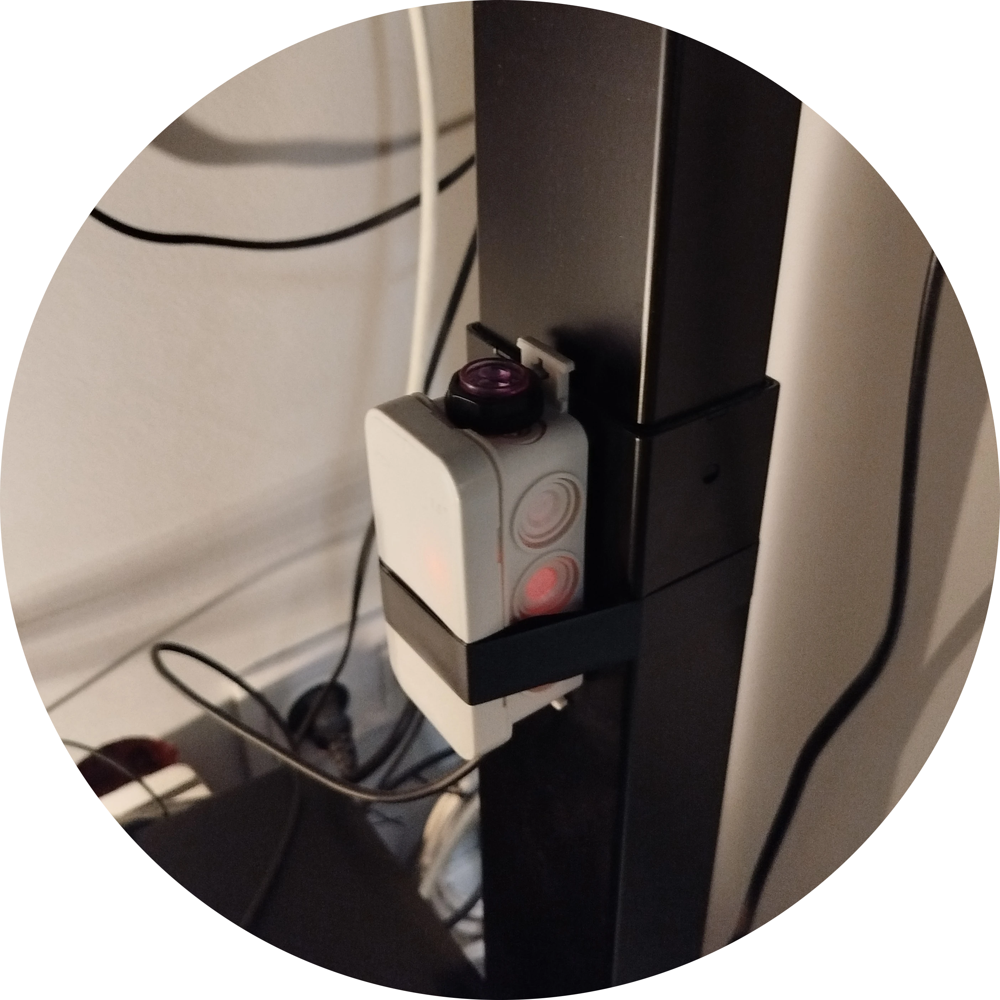

This is a simple Python app that connects to an Arduino with a distance sensor to track if your height-adjustable desk is up or down. It sits quietly in the system tray and reminds you to stand every hour.

More info [here](https://jakubkivi.github.io#portfolio-modal-ChairRorist)

<br clear="all" />

## Features

- Real-time desk position monitoring via Arduino sensor
- System tray integration with status indicators
- Configurable alert intervals and polling rates
- Hotkey support for timer reset
- In-tray serial port selection (persisted to app data)
- Persistent statistics tracking
- Windows notifications with custom alerts
- Comprehensive logging

## Installation

1. Clone the repository:

   ```bash
   git clone https://github.com/JakubKivi/ChairRorist.git
   cd ChairRorist
   ```

2. Install dependencies:

   ```bash
   pip install -r requirements.txt
   ```

3. (Optional) Configure settings in `config.json`

4. Build the executable:
   ```bash
   make build
   ```

## Configuration

The application can be configured via `config.json` (bundled read-only inside
the executable):

```json
{
  "serial": {
    "baudrate": 9600,
    "timeout": 1
  },
  "intervals": {
    "polling": 5,
    "alert": 3600
  },
  "hotkeys": {
    "reset_timer": "ctrl+shift+alt+d"
  }
}
```

The serial port is not part of `config.json`. It is selected from the tray
icon menu and persisted to the application-data directory (next to the
statistics file), independently of the build.

## Usage

1. Upload the Arduino sketch from `hardware/ChairRorist/` to your Arduino
2. Run the application
3. The app will appear in your system tray

## Development

The source lives in `software/src/` as the `chairrorist` package:

- Entry point: `software/src/main.py` (also runnable as `python -m chairrorist`)
- `chairrorist/app.py` — composition root (wires serial, state, tray, hotkeys)
- `chairrorist/config.py`, `chairrorist/status.py`, `chairrorist/paths.py`, `chairrorist/utils.py` — pure, unit-tested logic
- `chairrorist/notifications.py`, `chairrorist/tray.py`, `chairrorist/hotkeys.py`, `chairrorist/serial_monitor.py` — platform/IO adapters

Run the tests:

```bash
py -m pytest tests/ -v
```
